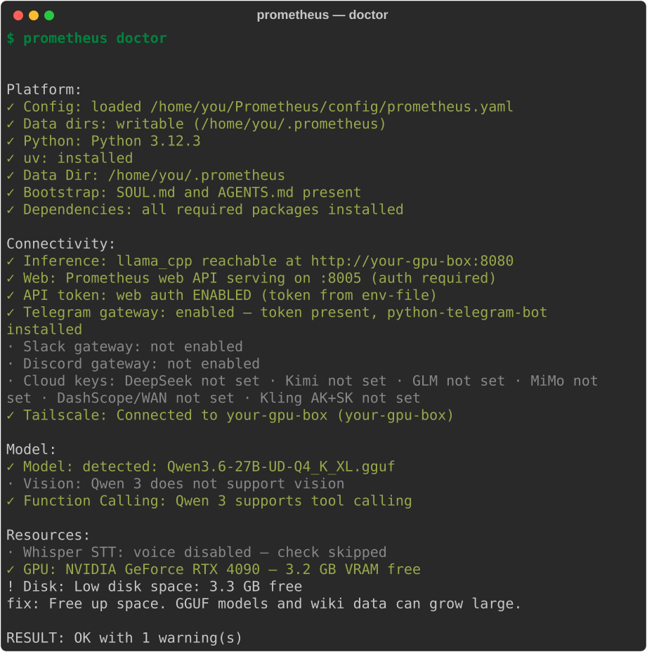
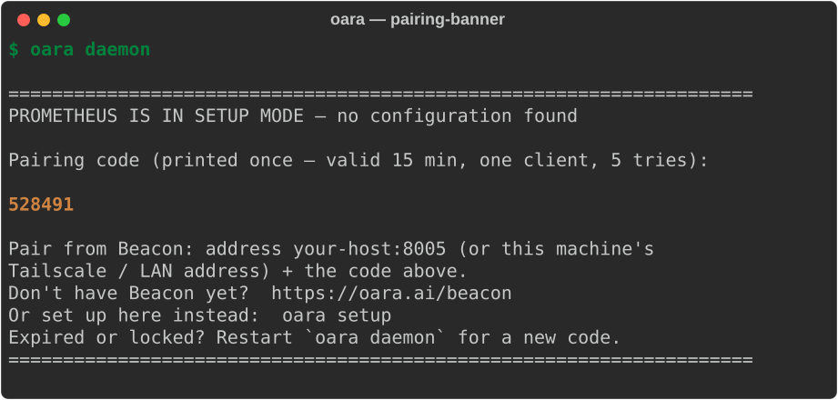
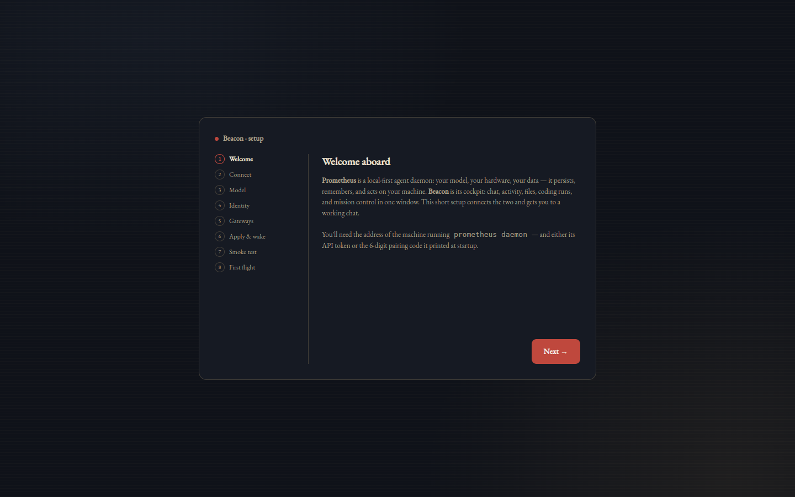
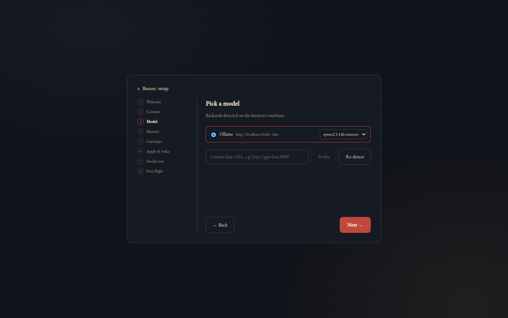
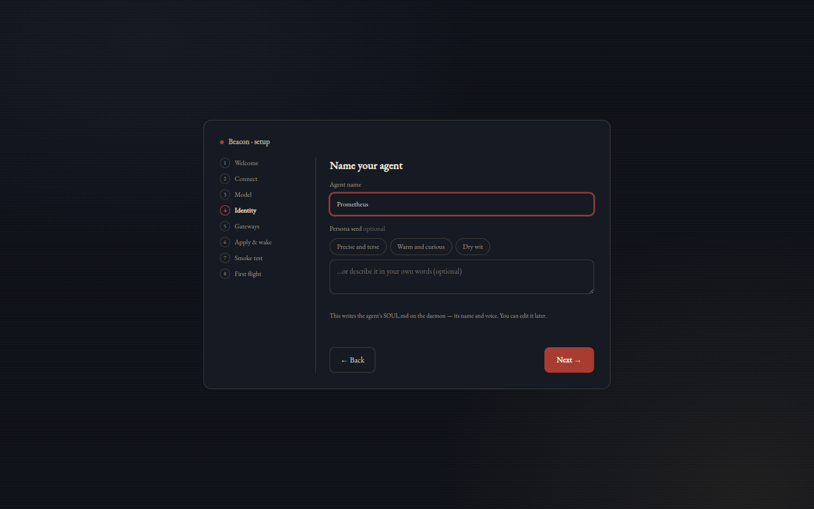
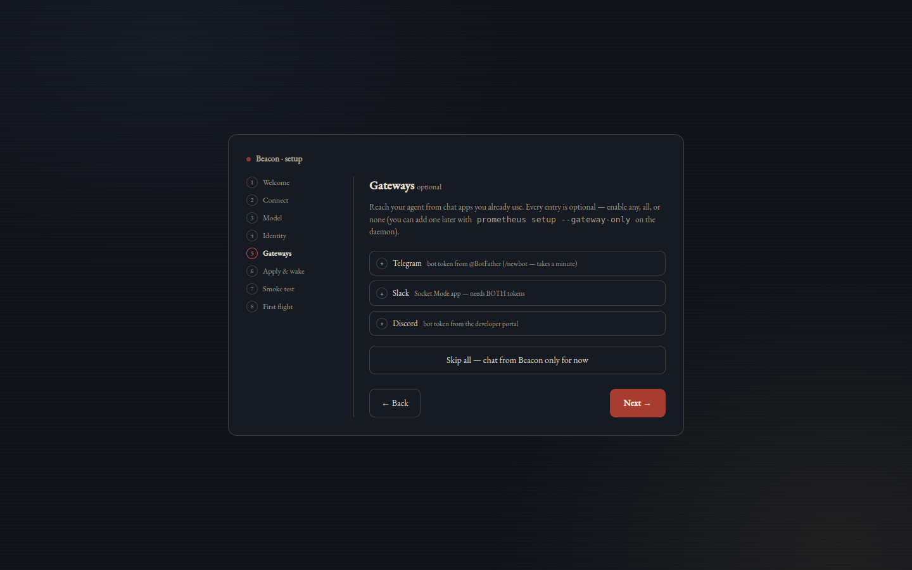
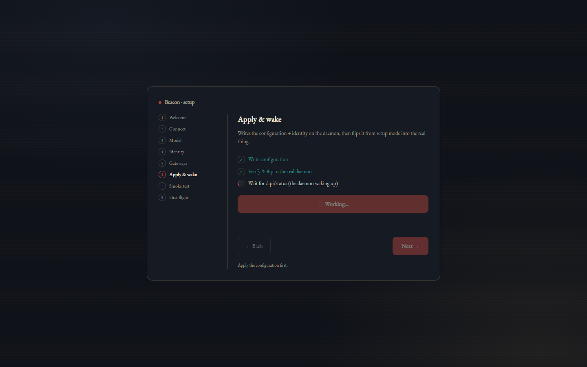
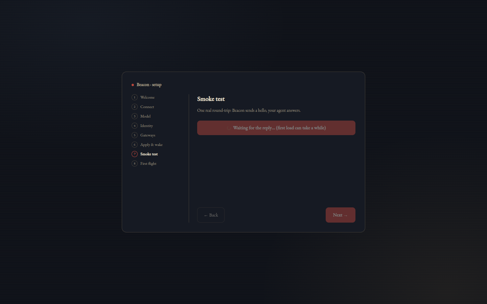
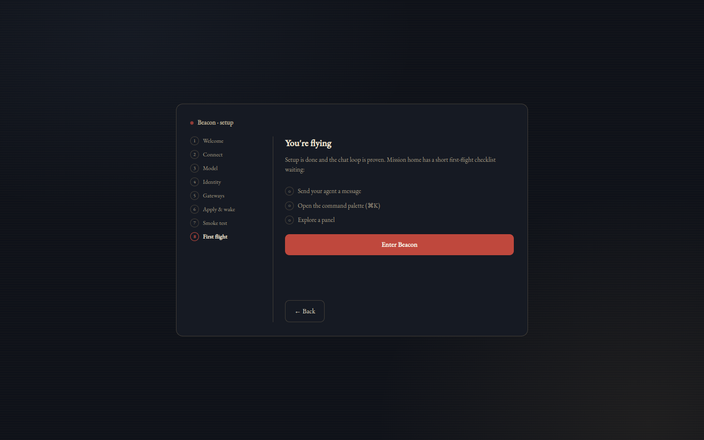

# Install & first flight

This page takes you from nothing to a running Prometheus daemon with Beacon connected — including the fully guided "couch mode" path, where the daemon boots into setup mode and Beacon's wizard does the rest. Every command here is copy-pasteable; where something is rough today (Homebrew verified on Apple Silicon only), the page says so instead of pretending otherwise.

[← README](../../README.md)

## Prerequisites

- **Python 3.11+** on the machine that will run the daemon. Check first — stock macOS ships 3.10, and against `requires-python >=3.11` pip answers *"No matching distribution found"*, which reads like the package does not exist:

  ```bash
  python3 --version
  ```

  Below 3.11, install a newer one (`brew install python@3.12`, or `uv python install 3.12` and `uv venv`) before anything else.

  **What is actually verified, at patch granularity.** `requires-python` says `>=3.11`,
  which is a claim about MINOR versions; CI resolves each matrix entry to the latest
  PATCH, so what is genuinely exercised today is **3.11.16** and **3.12.14**. Ubuntu
  24.04 — the likeliest self-hoster baseline — ships **3.12.3**, eleven releases behind
  that 3.12 leg, so a distro interpreter is close to what is tested but not identical to
  it. **3.13 is admitted by `requires-python` and tested**, and any of the three is fine.
- **An inference backend** — llama.cpp or Ollama running with any model loaded (LM Studio and vLLM also work), *or* a cloud API key (OpenAI, Anthropic, Gemini, xAI, DeepSeek, Kimi, GLM, MiMo, OpenRouter). The setup wizard probes for local servers and never writes a config it knows is broken.
- **Optional:** a Telegram bot token from [@BotFather](https://t.me/BotFather) if you want the Telegram gateway. The CLI and Beacon work without any gateway.

No GPU? Point Prometheus at a cloud provider and you still get the whole daemon — memory, wiki, security gate, coding runs, all of it.

## Install the daemon

On a Mac with an Apple chip the app below is the easiest start; on a Linux box (or any Mac you'd rather use a terminal on) pick one of the pip, Homebrew, Docker or OpenShell routes. Every one of them installs the same daemon and pairs with Beacon the same way.

A plain install, with no extras, runs `oara daemon` and pairs with Beacon: the web API (FastAPI, Uvicorn, websockets) is part of the base package. The pip commands below add `[full]`, which adds the Slack and Discord gateways, MCP, the Playwright browser tool, the Anthropic provider, and voice output (piper-tts, sounddevice, scipy). It does not add voice input (faster-whisper — the `voice` extra), `evals`, `push` or `computer`; install those by name if you want them. You can also install single extras — for example `pip install 'oara-prometheus[slack]'` adds just the Slack gateway. `pip install 'oara-prometheus[discovery]'` lets the daemon announce itself on your home network (mDNS) once you choose home network mode; without it everything else works and the daemon says so once in its log.

### The Mac app (no terminal)

**Prometheus.app** is a signed, notarized app for Apple silicon Macs on macOS 13 or later, published with every release as a zip. It carries its own Python 3.12, so it needs nothing already installed:

1. Download `Prometheus-mac-arm64.zip` from the [latest release](https://github.com/OAraLabs/Prometheus/releases/latest) — that name always points at the newest version. Unzip it and drag **Prometheus** into your Applications folder.
2. Open it. macOS may say the app came from the internet the first time; **Open** it once and it won't ask again.
3. It installs the daemon as a **login item**, so your assistant keeps running when you close the app. macOS will show a note about Login Items — that's expected.

Three things worth knowing about the app install:

- It listens on **this Mac only** until you say otherwise, so nothing on your network can reach it by default. See [Remote access](#remote-access-over-tailscale).
- It starts in the **`cautious`** permission mode: every shell command the model runs, and every file write, asks you first. `/gate cautious` selects the same mode anywhere. macOS has no kernel write boundary equivalent to the one Linux gets from bubblewrap, so on the app the prompt is the protection.
- Up to 0.9.8 it ships **without PyMuPDF** (its license is AGPL), so PDF text extraction and image downscaling aren't available in the app install. From 0.9.9 both use pypdfium2 and Pillow (permissive licences), which the app carries, so PDFs and large images work there too.

Beacon on the same Mac pairs with it automatically, using a one-time file secret (`POST /api/pair/local`) — no code to type. If you reinstall Beacon, `Prometheus --pair` writes a fresh secret.

You can install the daemon from a terminal instead; the app is a convenience, not a requirement.

### On Linux, and in a terminal

On a Linux server you can run the daemon in a container instead: the image is built for amd64 and arm64, with a compose example that runs it beside Ollama. See [Docker](docker.md). To run the daemon **confined** — its own container, default-deny network egress, filesystem limited to its workspace — see the [OpenShell sandbox](openshell.md), which is tested with OpenShell 0.1.3 on Linux amd64.

**One command, from Git** — an isolated install of the `oara` command straight from `main`, with [uv](https://docs.astral.sh/uv/) or pipx:

```bash
uv tool install 'oara-prometheus[full] @ git+https://github.com/OAraLabs/Prometheus'
# or: pipx install 'oara-prometheus[full] @ git+https://github.com/OAraLabs/Prometheus'
```

**From source** — best if you want to read or change the code, or run the test suite:

```bash
git clone https://github.com/OAraLabs/Prometheus.git && cd Prometheus
pip install -e '.[full]'
```

**From PyPI** — the packaged release, [`oara-prometheus`](https://pypi.org/project/oara-prometheus/) (first published at 0.9.0):

```bash
pip install 'oara-prometheus[full]'
```

**With Homebrew** — Apple Silicon Macs (M1 and later) only; Intel Macs aren't verified yet:

```bash
brew install oaralabs/tap/oara
```

Use the full name: a bare `brew install oara` fails because the tap isn't trusted. The install takes a few minutes, since every Homebrew dependency comes prebuilt, and like a plain pip install it runs `oara daemon` and pairs with Beacon.

## Run setup

```bash
oara setup
```

> The command is `oara`. `prometheus …` still works as an alias during the deprecation window; the package, the import path, `~/.prometheus`, and the `prometheus.service` unit name are unchanged.

The wizard detects your inference server (llama.cpp on `:8080`, Ollama on `:11434`, LM Studio on `:1234`, vLLM on `:8000`), generates your agent's identity (`SOUL.md`), writes a working config with the web API enabled, and smoke-tests the loop with one real round-trip. If no server is running it offers a remote URL, a cloud provider, or copy-paste install instructions. With no prompts allowed (`--noninteractive`) and no server found, exactly one cloud key in your environment or env file picks that provider; several keys is refused with a `--provider` hint, none exits 2 with install instructions. A key found only in your shell is copied into the env file so `oara daemon` has it too.

Variants:

```bash
oara setup --fast            # quick path: probe local servers, write yaml + env — 3 questions
oara setup --noninteractive  # zero questions (implies --fast): first detected server, CLI gateway
oara setup --provider openai # zero questions: THIS cloud provider; its key must be in $OPENAI_API_KEY or the env file
ANTHROPIC_API_KEY=sk-… oara setup --noninteractive   # no GPU, no local server: one cloud key in the environment is enough
oara setup --gateway-only    # add or change Telegram, Slack, or Discord later
```

Note that `--fast` skips identity generation and the smoke test — it's for when you just want a config on disk.

Then run it:

```bash
prometheus                # interactive CLI chat
oara daemon         # always-on: web API + gateways + cron + background layer
```

On a terminal, `oara daemon`, `oara setup` and the interactive chat start with a short banner: the wordmark, then the port the daemon listens on and the model it serves, once each is known. It shows the port only, never an address, a token or a path. It is not printed when stdout isn't a terminal (a service, a pipe, CI), for `oara --once`, with `--quiet` (`-q`), or with `OARA_NO_BANNER=1`; with `NO_COLOR` set it is plain text. `oara --version` prints one line, `◉ prometheus <version> · OAra Labs`.

## The API token

On the **first** daemon start, Prometheus mints a secure `PROMETHEUS_API_TOKEN`, saves it to `~/.config/prometheus/env`, and prints it **once**. Everything that talks to the daemon's REST or WebSocket surface — including Beacon — presents this token.

```bash
oara token show     # re-print the current token
oara token rotate   # invalidate it and mint a new one
```

Quick sanity check that the API is up and authed:

```bash
curl -H "Authorization: Bearer $(oara token show | head -1)" http://localhost:8005/api/status
```

Secrets never go in the yaml config — they live in that env file, which both `oara daemon` and the systemd unit load.

## Run as a service (Linux and macOS)

`oara install-service` installs the daemon as a user service for the system you are on: a systemd user unit on Linux, a LaunchAgent on macOS.

**Linux**

```bash
oara install-service          # writes ~/.config/systemd/user/prometheus.service
systemctl --user start prometheus
journalctl --user -u prometheus -f  # follow the logs
```

It also does the `daemon-reload` and `enable` for you.

**macOS** has no systemd, so it writes a LaunchAgent instead:

```bash
oara install-service          # writes ~/Library/LaunchAgents/com.oaralabs.prometheus.daemon.plist
oara install-service --now    # also loads it now (launchctl enable, then bootstrap)
```

Without `--now` it only writes the plist, and says so: launchd loads the plists in `~/Library/LaunchAgents` at your next login, which is the macOS equivalent of `systemctl enable`. Like the Linux unit, the LaunchAgent restarts the daemon when it exits with an error (never more often than every ten seconds) and leaves it stopped after a clean exit. launchd keeps the daemon's stderr in `~/Library/Logs/Prometheus/launchd.err.log`; the daemon's own log is still `~/.prometheus/logs/daemon.log`. The daemon reads its secrets from the same env file as before, so the plist carries none.

If something else has already registered that job label with launchd (for example an app that supervises the daemon, or a plist you wrote by hand) and this command has not written a plist of its own, `install-service` stops and changes nothing. Two supervisors for one daemon is a bug, and `--force` does not override it: `--force` only replaces the plist this command wrote.

**Flags and exit codes**

- `--now` starts the service immediately (Linux: `systemctl start`; macOS: `launchctl enable` then `bootstrap`).
- `--force` replaces an existing unit or plist that differs from what would be written, saving the old one as `.bak` first. Without it, a differing file is left alone.
- `--systemd-dir` (Linux) and `--launch-agents-dir` (macOS) choose a nonstandard target directory. Each is rejected on the other system.

Exit codes:

| Code | Meaning |
|---|---|
| `0` | Installed, or already installed and up to date (nothing was touched) |
| `1` | Not done: a differing unit or plist was refused without `--force`, another supervisor owns the macOS job, or `systemctl` / `launchctl` is missing or failed |
| `2` | An option that does not apply on this system (`--systemd-dir` on macOS, `--launch-agents-dir` on Linux) |

A missing `systemctl` or `launchctl` is exit `1`, not a warning, so a script never mistakes a service that was never enabled for a success. Any unit or plist already written stays in place, and the message says where.

## When something is off: `oara doctor`

```bash
oara doctor
```

Doctor checks every subsystem — config, backend reachability, token, gateways, service state — and prints a fix hint next to each failure:



The exit code is nonzero when anything is broken, so it also works in scripts and CI.

## Install Beacon

Beacon is the native desktop cockpit (macOS / Linux). It is free to use but not open source, and it is in beta. Every release publishes its builds — a `.dmg` for macOS (Apple silicon), an `.AppImage` and a `.deb` for Linux — from the [releases page](https://github.com/OAraLabs/beacon/releases/latest), which is what [oara.ai/beacon](https://oara.ai/beacon) reads. Once you have a build, the notes below apply:

- **macOS (Apple Silicon)** — download `Beacon-<version>-arm64.dmg` and drag Beacon to Applications. The published macOS app and disk image are **signed, notarized and stapled** with an Apple Developer ID, so Gatekeeper opens them without a warning. (The Linux builds are not signed.)

- **Linux (AppImage)** — universal, no install step:

  ```bash
  chmod +x Beacon-*.AppImage && ./Beacon-*.AppImage
  ```

- **Linux (deb)**:

  ```bash
  sudo apt install ./Beacon-<version>-amd64.deb
  ```

## The guided install (couch mode)

You don't have to run `oara setup` in a terminal at all. If you start the daemon with **no config**, it boots into **setup mode** — a pairing-only API that prints a one-time 6-digit code and waits for Beacon to drive the rest:

```bash
oara daemon
```



From here, everything happens in Beacon's 8-step wizard. Walkthrough, step by step:

### 1. Welcome

First launch opens the wizard. It sets expectations for the flow ahead — connect, pick a model, name your agent, gateways, apply, verify.



### 2. Connect (pairing)

Enter the daemon's address and the 6-digit code from the banner. Already have an API token (from an existing install)? The escape hatch takes `address + token` directly instead. The **Test** button probes the daemon before anything is saved and tells you exactly which state you're in: *unreachable*, *auth rejected*, *connected*, or *setup mode*.


### 3. Model

The wizard asks the daemon to probe for inference servers on its own host — llama.cpp `:8080`, Ollama `:11434`, LM Studio `:1234`, vLLM `:8000` — and shows what it found. Your model server can live anywhere the daemon can reach; there's a custom base URL field with its own **Probe** button for remote or nonstandard setups.



### 4. Identity

Name your agent and give it a persona seed. This generates `SOUL.md` — the persistent identity that rides every prompt and survives `/reset`. No hardcoded names anywhere.



### 5. Gateways

Optionally wire up Telegram, Slack, or Discord. All three are genuinely optional — **"Skip all" is a perfectly good answer**, and `oara setup --gateway-only` can add any of them later.



### 6. Apply & wake

The wizard writes the config and the daemon **wakes fully configured in the same process** — no restart, no re-pairing. Setup mode ends and the real API comes up.



### 7. Smoke test

One real chat round-trip through the whole stack — Beacon → daemon → model → back — so you know the loop actually works before you're done.



### 8. First flight

A short checklist of things to try first — your launch pad into the app.



And you land on Mission home, connected to your freshly installed daemon:


## Reach it from your home network

Tailscale covers two machines you control. To reach the daemon from a **phone, a tablet or a laptop that isn't on your tailnet** — anything else on your home Wi-Fi — turn on home network mode. In Beacon that's the network control in Settings; in the config file it's `network.home_network: true`. The daemon has to restart for it to take effect, and Beacon's **Apply** does that for you.

What changes when it's on:

- The daemon serves **TLS on port 8006** (REST) and **port 8011** (WebSocket) to your network — `web.tls_api_port` and `web.tls_ws_port`. Open both in your firewall if you have one.
- **Plain HTTP then listens on 127.0.0.1 only.** Port 8005 and port 8010 stop answering from your network. That's the point: once the daemon is reachable beyond this machine, nobody gets a cleartext bearer token flying over Wi-Fi. To undo it you set `network.allow_plaintext_lan: true` yourself — the API will never write that line for you.
- The certificate is made over the daemon's **instance key** (P-256, TLS 1.2 or later, AEAD ciphers only). It's self-signed, so a browser will warn about it; clients are expected to **pin** it instead. `GET /api/hello` advertises `fp`, the first 16 hex characters of the certificate's SHA-256, and `GET /api/network` gives the full value as `tls.spki_sha256` — a client matches what it discovered to what it pinned. Beacon does this for you.
- With the optional `[discovery]` extra installed, the daemon announces itself as `_prometheus._tcp` on private addresses, so Beacon's "Look for another computer" finds it without you typing an address. Without that extra everything still works; you type the address.

Home network needs TLS. If this daemon has no instance key to make a certificate over, the switch refuses with `409 tls_unavailable` rather than quietly serving your network in plaintext.

`oara doctor` reports home-network mode honestly: whether it can work, whether it's safe, and whether the daemon will announce itself.

A second computer that joins over TLS is told to connect back on `https://` and `wss://` with the certificate pin to check, so a device paired in home-network mode can actually reach the daemon afterwards.

## Reach it from a specific address

`web.bind` picks the interface: `0.0.0.0` for every interface, `127.0.0.1` for this machine only, or one specific address such as a tailnet IP or `192.168.1.20`. Precedence is `--bind` > `PROMETHEUS_WEB_BIND` > `web.bind` > `0.0.0.0`, and an invalid value refuses to start rather than guessing. One specific address has a consequence worth knowing before you pick it — see [Known issues](#known-issues).

## Make a Beacon on another computer the owner

A Beacon on the machine the daemon runs on pairs automatically. A Beacon on a **second** computer can join too, but by default it gets an ordinary *scoped* device: it sees only the conversations it creates, and — the part that matters — it **cannot approve a worker's request**. The API token can't either, because a model can read it.

To give that second Beacon real authority, run this on the machine Prometheus runs on:

```bash
oara pair --owner
```

It prints a one-time code — 8 digits, shown as `1234-5678` — good for **5 minutes** and one use, then waits and tells you who used it and from which address. Type the code into **Settings** on the other computer's Beacon. That Beacon gets its own owner device token, and the terminal warns as soon as anyone types a wrong code. Ctrl-C cancels.

Worth knowing:

- The code prints **only to a terminal**. Piped, or run by the agent's own shell, it asks for no code at all — so it can't end up in a transcript or a log. Over ssh, use `ssh -t`.
- **Wrong guesses can't switch the code off.** Five wrong tries from one address shut that address out, and the daemon caps how many wrong tries it compares in a minute across everyone. No number of guesses ends a code, so a stranger can delay a redemption but never cancel one.
- Minting a code needs the API token **from that machine**. An owner device can't mint one, so this doesn't cascade.
- Redeeming is a new token on the wire, so do it over TLS, a tailnet or loopback.
- Re-pairing the daemon's own Mac never revokes this device, and neither does another computer redeeming its own code. Each computer keeps its own owner device; you revoke one from the device list in Beacon.

Full behavior, including every route and its error codes, is in the [API guide](api.md#ports--remote-access) and `docs/contracts/device-scoping.md`.

## Known issues

- **Worker approvals fail closed when `web.bind` is one specific address.** A spawned worker asks for approval on the address the daemon is actually bound to. That route is accepted only from this machine — a loopback peer *and* a `Host` header that names loopback — and a bind of `192.168.1.20` makes the worker's `Host` header `192.168.1.20`, so the daemon answers `403 not_loopback` and the request never reaches the approval queue. The worker then waits for an answer nobody can give. This is the refusal working as designed; it just isn't what you want. Use `0.0.0.0` (the worker reaches it on `127.0.0.1`), or loopback, or home-network mode instead.

## Remote access over Tailscale

The daemon doesn't have to be on the same machine as Beacon. If both are on your tailnet, pair Beacon to `<tailnet-hostname>` (or the Tailscale IP) instead of `localhost` — the ports are fixed at `:8005` for REST and `:8010` for WebSocket, so the address is all you type. The same works over a LAN, WireGuard, or anything else that routes.

Nothing but the daemon's address and the token leave your machine, and the token is stored in the OS keychain — it never reaches Beacon's renderer process again after you save it.

A new install listens on **this machine only** (`web.bind: 127.0.0.1`), so for remote access you set the bind on purpose: `web.bind: 0.0.0.0` (every interface) or a tailnet address, in `prometheus.yaml`, or `oara daemon --bind …`, or `PROMETHEUS_WEB_BIND` in the environment (highest first). An install that predates that default, with no `web.bind` at all, still listens on **every interface** and keeps working. Either way it is plain HTTP with no TLS, so the bearer token is the only access control between the API and whoever can route to the machine, unless home-network mode is on: `network.home_network: true` serves the LAN over TLS on 8006 and 8011 and keeps plain HTTP on 127.0.0.1 (see [the API guide](api.md#ports--remote-access)). `oara doctor` warns while `web.bind` is unset and the daemon would listen on every interface. A headless box you set up from another machine (Beacon driving setup mode) ends up loopback-only afterwards unless you started it with `--bind`: set `web.bind` on the box to reach it again. The flag also covers setup mode, whose pairing endpoint is reachable for up to 15 minutes. The full rules are in [the API guide](api.md#listening-on-this-machine-only).

## Troubleshooting

- **Something's broken and you don't know what** — `oara doctor`. It checks every subsystem and prints a fix hint per failure; nonzero exit when anything fails.
- **Lost the API token** — it was only printed once, but `oara token show` re-prints it any time. `oara token rotate` if you think it leaked. It lives in `~/.config/prometheus/env`.
- **macOS refuses to open Beacon** — the published macOS build is signed and notarized, so this shouldn't happen with a downloaded release. If it does, the `.dmg` was damaged in transit or the app was rebuilt from source without signing credentials: re-download it, or right-click → **Open** → **Open** once for an unsigned build.
- **Pairing code rejected or expired** — codes are strict by design: each one lives **15 minutes**, pairs **one client**, and allows **5 wrong attempts** before locking. Restart the daemon (`oara daemon`) to mint a fresh code and try again. Only a wrong code burns an attempt.
- **Beacon connects but shows auth errors** — the token Beacon stored no longer matches the daemon's (e.g. after a rotate). Open Connection Settings (`⌘,`), paste the output of `oara token show`, and hit **Test**.

## Upgrading (and what a downgrade actually does)

**Upgrade in place** — for the git install the README documents:

```bash
cd Prometheus && git pull && pip install -e '.[full]'
```

then restart the daemon. Your state — `~/.prometheus/*` (databases, sessions, cron jobs, workspace, identity files), your config, and your API token — is not touched by the upgrade itself; schema changes are applied additively the first time the new code opens each store. This is not a promise made from reading the code: `scripts/firstlight_upgrade_harness.py` installs the oldest supported tag (`v0.1.0`), lives in it (turns, sessions, cron, files), upgrades in place, and fails CI if any table, row, or user file goes missing.

Two honest caveats the harness itself reports:

- **An upgraded install keeps its old config** — fixes that ship as *better setup defaults* (for example the advertised-tools default) don't reach a config written by an older version. After upgrading, compare your `prometheus.yaml` against `config/prometheus.yaml.default` for new sections worth adopting, or re-run `oara setup` in a scratch directory to see what a fresh config looks like.
- **Downgrading is not supported, and here is precisely what it does:** tested empirically (HEAD state, `v0.1.0` code) — the old daemon boots, a turn completes, and every table remains readable, so a downgrade is **probably readable but lossy**: columns and stores added since the old version are invisible to it, and anything written into new locations effectively vanishes until you upgrade again. If you must roll back, snapshot `~/.prometheus/` first and treat the downgraded run as read-mostly. We say this plainly rather than pretending it's covered.

Next: the [feature reference](features.md) for what everything does, or the [Beacon guide](beacon.md) for a tour of the app you just installed.
